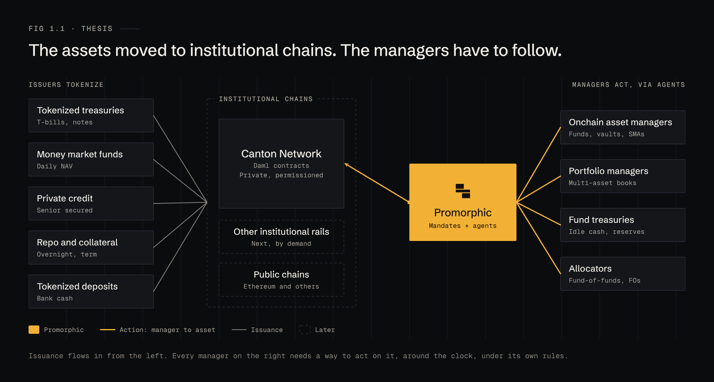
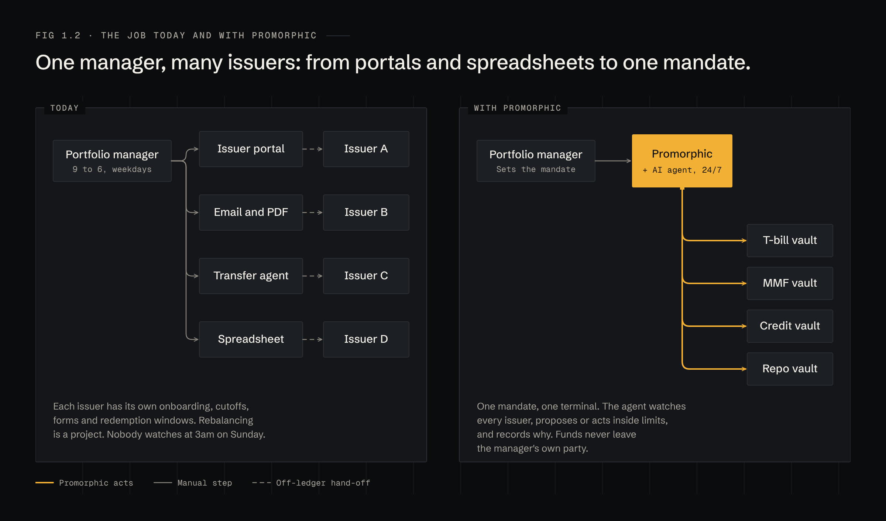

# 1 · Thesis

## The assets moved. The managers have to follow.

Tokenized treasuries, money market funds, private credit, repo collateral and tokenized deposits are being issued on institutional chains. Canton is where much of that activity is concentrated: permissioned, private by default, with Daml contracts that say exactly who may do what. The site's own figure for activity on Canton is $9T a month (Canton, self-reported, 2026).

Issuers chose these chains because their clients need privacy, known counterparties and legal finality. The asset managers and portfolio managers who buy those assets now need to operate on the same chains. They need the same things a desk has always needed: a view of the book, rules for what it may hold, and a way to act fast. Today they have none of it onchain.

**Why Canton first.** It is where the tokenized assets are being issued, and its model suits mandates. A Daml contract names its signatories and the parties allowed to exercise each choice, so "this agent may rebalance, and may not withdraw" is something the ledger enforces, not a promise in a terms of service. Other institutional chains follow by demand; public chains come after that.

## The job today

A manager allocating across five tokenized funds deals with five onboarding flows, five subscription cutoffs, five redemption policies and five ways of publishing NAV. Rebalancing is a project. A redemption gate announced at 06:00 on a Sunday is read on Monday.

With Promorphic the manager writes the rules once, as a mandate. An AI agent watches every issuer and every position against those rules, all the time. It proposes, or acts within limits, and writes down why. The manager's funds never leave the manager's own party.

## Who is who

Promorphic sits between three groups and makes each one useful to the others.

- **Customers: onchain asset managers and portfolio managers.** They own the funds, sign the mandate and approve what needs approving. Fund treasuries and allocators are the same shape of customer.
- **Distribution partners: issuers.** Each tokenized instrument is listed as a vault with a structured due diligence pack. Listing on Promorphic puts the issuer in front of every manager on the platform, and every agent acting for them.
- **Execution partners: AI agents.** Frontier models, or the manager's own agent, connect through the Promorphic agent gateway. They decide what to do. Promorphic constrains, executes and records.

## Why now

Three things are true at once:

1. **The assets are onchain.** Institutional issuance on permissioned chains has moved from pilots to production.
2. **The agents are ready.** Models can now read a prospectus, reason about a mandate and call tools reliably enough to propose real trades.
3. **The control layer is missing.** No one lets an agent near a fund's book without hard limits, approvals and a record. That layer is the product.
