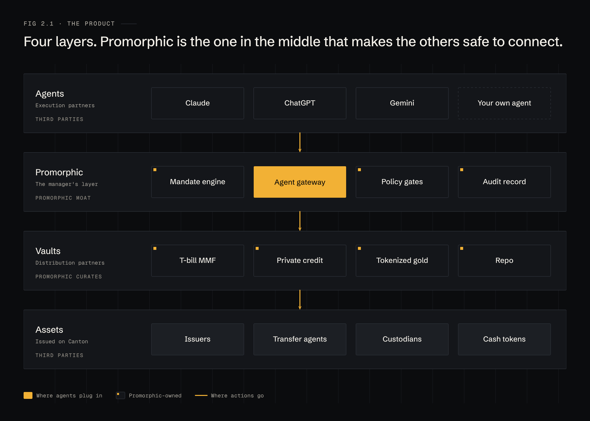
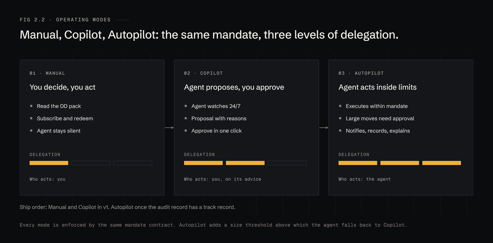

# 2 · Product

## Four layers

| Layer | Owned by | Job |
|---|---|---|
| **Agents** | Execution partners | Read the book and the mandate; decide what to propose |
| **Promorphic** | Promorphic | Mandate engine, agent gateway, policy gates, audit record |
| **Vaults** | Promorphic curates, issuers distribute | One instrument each, with terms and a DD pack |
| **Assets** | Issuers, transfer agents, custodians | The tokenized instruments and cash on Canton |

The vaults are necessary and easy to copy. The middle layer is the moat: a mandate that is a contract, a gateway that lets any agent act safely, and a record an auditor will accept.

## Three operating modes

| Mode | Who acts | What the agent does | When to use it |
|---|---|---|---|
| **Manual** | The manager | Nothing. The manager reads DD and subscribes or redeems by hand | First weeks; vaults outside the mandate |
| **Copilot** | The manager, on the agent's advice | Watches 24/7, proposes moves with reasons; approvers sign | Default for every new mandate |
| **Autopilot** | The agent, inside limits | Executes moves at or under the size threshold; larger moves fall back to Copilot | Routine sweeps and rebalances once the record is clean |

All three modes run under the same mandate contract. The mode is a field in the mandate, so changing it is a signed amendment, not a settings toggle.

**Ship order.** Manual and Copilot first. Autopilot follows once the audit record shows a run of proposals that approvers accepted unchanged.

## Who it is for

| Customer | Typical book | What they buy |
|---|---|---|
| Onchain asset manager | Funds and SMAs holding tokenized T-bills, MMFs, credit | A yield sleeve that rebalances itself and never breaks the prospectus |
| Portfolio manager | Multi-asset book across issuers | One view of exposure, liquidity and limits across every issuer |
| Fund treasury | Idle cash, reserves, redemption buffers | Cash swept into yield and back before it is needed |
| Allocator | Fund-of-funds, family offices | Independent DD and a record of every allocation decision |

The interface is a terminal, not a retail app. See [The terminal](09-terminal.md).
