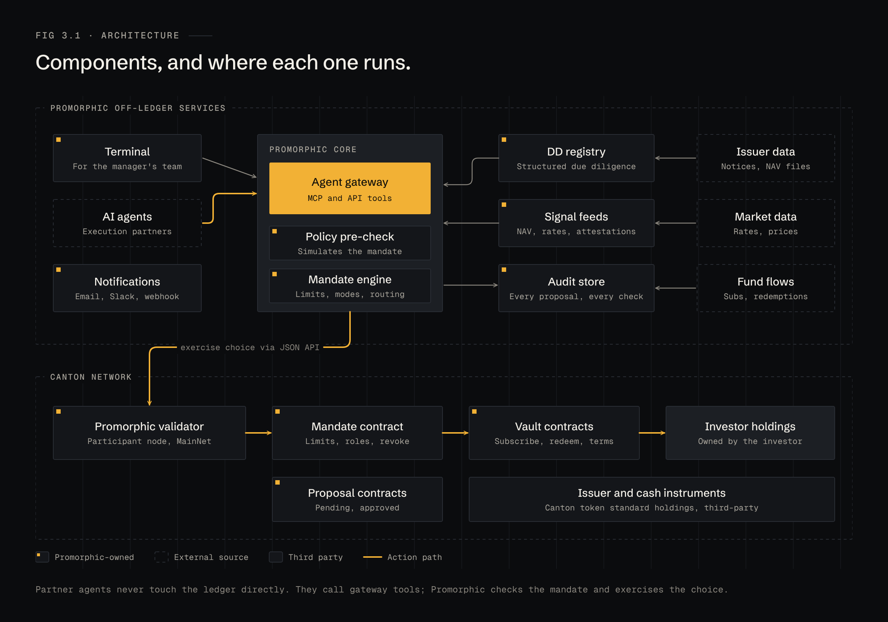
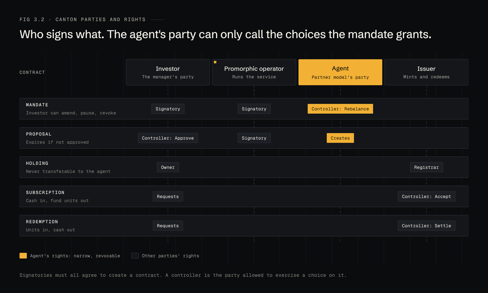
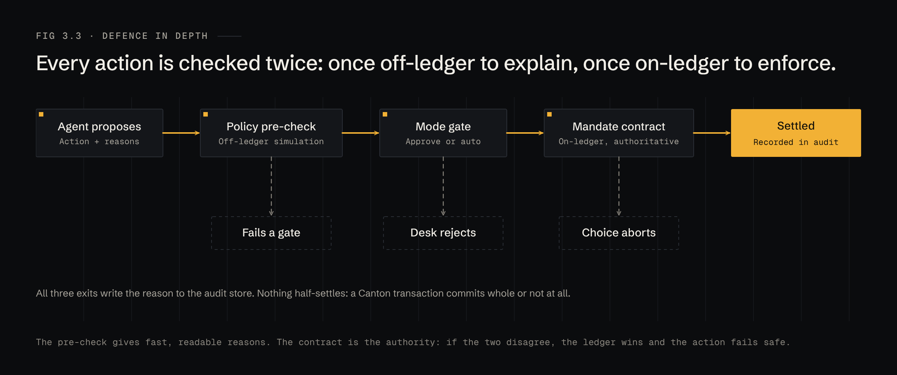

# 3 · Architecture

## Components

**Off-ledger (Promorphic services)**

| Component | Job |
|---|---|
| Terminal | Web app for the manager's team: book, vaults, mandate, proposals, record |
| Agent gateway | The only way an agent reaches Promorphic. MCP and REST tools, scoped per mandate |
| Policy pre-check | Simulates the mandate against a proposed action and returns pass or fail with numbers |
| Mandate engine | Holds mandate state off-ledger, routes proposals by mode and threshold |
| DD registry | Structured due diligence for every vault; source documents attached |
| Signal feeds | NAV, rates, attestations, issuer notices, normalised and time-stamped |
| Audit store | Every context, proposal, gate result, signature and ledger reference |
| Notifications | Email, Slack and webhooks to approvers |

**On-ledger (Canton)**

| Contract | Job |
|---|---|
| Mandate | The manager's rules: universe, limits, triggers, mode, approvers. Grants the agent's party one choice: Rebalance |
| Proposal | A pending action with its reason hash and expiry; approvers exercise Approve |
| Vault | The instrument's terms and the subscribe and redeem workflow with the issuer |
| Holdings | Canton token standard holdings, owned by the manager's party |

Promorphic runs its own Canton validator and participant node, and talks to the ledger through the participant's JSON API.

## Parties and rights

Four kinds of party take part:

- **Investor** — the manager's own party. Owns every holding. Signs the mandate. Approves proposals.
- **Promorphic operator** — co-signs the mandate so the service can act on it. Owns nothing.
- **Agent** — a party per connected agent, hosted by Promorphic. Its only right is the Rebalance choice on one mandate, and only while that mandate is active.
- **Issuer** — accepts subscriptions and settles redemptions for its own instruments.

The design rule: **no contract gives the agent or the operator a choice that moves value to a party other than the investor.** A withdrawal is a choice only the investor holds.

## Defence in depth

Every action is checked twice:

1. **Off-ledger pre-check.** Fast, and it explains itself: which gate, which number, which limit. This is what the manager reads.
2. **On-ledger mandate check.** The Rebalance choice re-evaluates the limits inside the Daml transaction. If the two checks disagree, the ledger wins and the action fails. A Canton transaction commits whole or not at all, so nothing half-settles.
