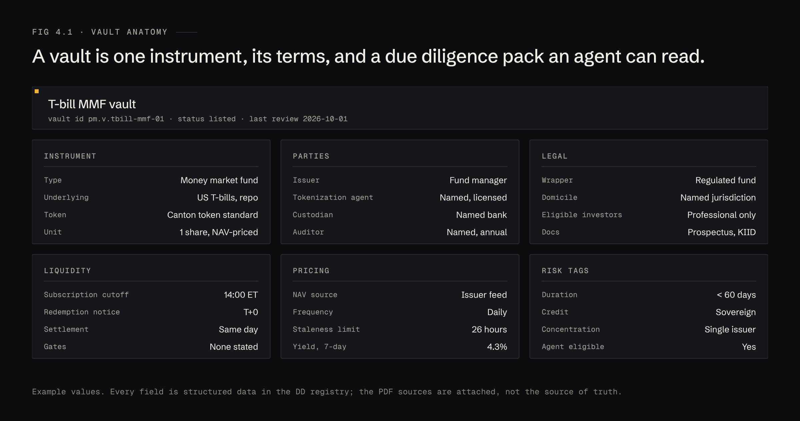
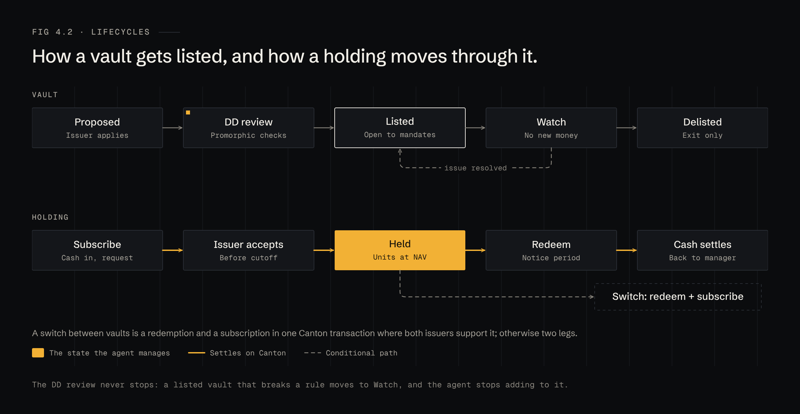

# 4 · Vaults

A vault is one tokenized instrument, its terms, and a due diligence pack written as data. Vaults are how issuers distribute through Promorphic, and what agents reason over.

## Anatomy

Every vault carries six groups of fields:

| Group | Fields |
|---|---|
| Instrument | Type, underlying, token standard, unit |
| Parties | Issuer, tokenization agent, custodian, auditor |
| Legal | Wrapper, domicile, eligible investors, source documents |
| Liquidity | Subscription cutoff, redemption notice, settlement, gates |
| Pricing | NAV source, frequency, staleness limit, yield |
| Risk tags | Duration, credit, concentration, agent-eligible |

The fields are the source of truth; the PDFs are attached as evidence. That is what lets an agent cite "DD field `liquidity.gates`" in a proposal, and lets the manager check it.

**Vaults hold nothing on the manager's behalf.** A vault is a listing and a workflow. When a manager subscribes, the fund units land in the manager's own party. There is no pooled Promorphic fund in the middle, so Promorphic is not the issuer, the fund manager or the custodian.

## Lifecycles

**Vault:** Proposed → DD review → Listed → Watch → Delisted. A listed vault that breaks a rule (late attestation, NAV deviation, a gate) moves to Watch. On Watch, agents may not add to it and mandates' triggers decide whether to exit. When the issue is resolved it returns to Listed.

**Holding:** Subscribe → Issuer accepts → Held → Redeem → Cash settles. A switch between vaults is a redemption and a subscription, in one transaction where both issuers support it.

## The catalogue

## Vault detail

The subscribe panel knows the mandate. It shows the weight after the trade and, if a limit would break, the largest size that fits and where else there is room.

## Listing criteria

- Issued on Canton under the Canton token standard, with a named issuer, tokenization agent and custodian.
- Published NAV at least daily, with a stated staleness limit.
- Subscription and redemption terms in writing, including any gate.
- Attestation or audit on a stated schedule.
- Professional-investor eligibility that matches Promorphic's customers.
