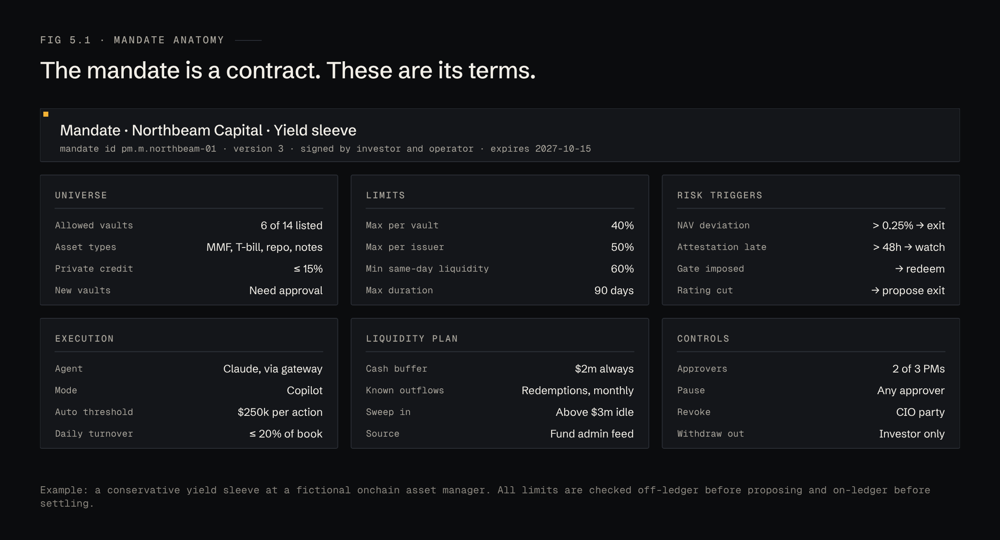
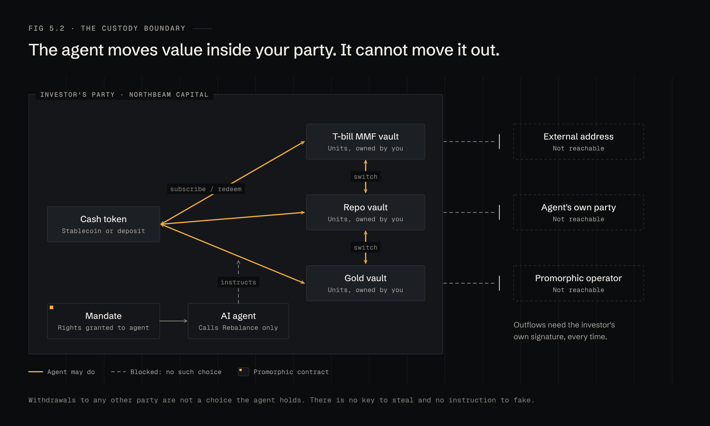
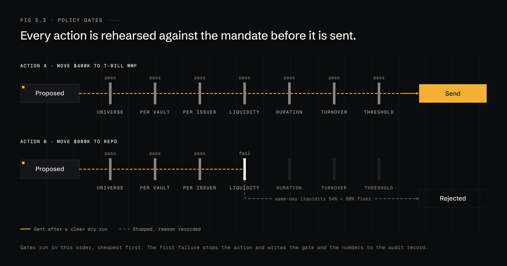

# 5 · Mandate

The mandate is a Daml contract signed by the manager and by Promorphic. It is the rulebook every agent action is checked against, and the reason the agent can act without ever holding the manager's funds.

## Anatomy

| Section | Example terms |
|---|---|
| Universe | Allowed vaults, asset types, caps on riskier types, approval for new vaults |
| Limits | Max per vault, max per issuer, minimum same-day liquidity, maximum duration |
| Risk triggers | NAV deviation, late attestation, gate imposed, rating cut, each with an action |
| Execution | Agent, mode, auto threshold, daily turnover cap |
| Liquidity plan | Cash buffer, known outflows, sweep line, data source |
| Controls | Approvers and quorum, who may pause, who may revoke, who may withdraw |

A mandate is versioned. A change is a new contract that replaces the old one only when every required party has signed.

## The custody boundary

Inside the manager's party the agent can move value between cash and vaults, and between vaults. It cannot move anything out, because no such choice exists for it:

| The agent can | The agent cannot |
|---|---|
| Subscribe to an allowed vault with the manager's cash | Send assets or cash to any other party |
| Redeem from a vault back to the manager's cash | Change the mandate, its limits or its approvers |
| Switch between allowed vaults | Approve its own proposals |
| Propose anything, with a reason | Act while the mandate is paused or revoked |

Outflows need the investor's own signature, every time.

## Policy gates

Every proposed action is run against the gates in this order, cheapest first:

| # | Gate | Passes when |
|---|---|---|
| 1 | Universe | The vault and asset type are allowed |
| 2 | Per vault | Weight after ≤ max per vault |
| 3 | Per issuer | Issuer weight after ≤ max per issuer |
| 4 | Liquidity | Same-day liquidity after ≥ the floor |
| 5 | Duration | Weighted duration after ≤ the maximum |
| 6 | Turnover | The day's turnover including this action ≤ the cap |
| 7 | Threshold | Routes the action: auto if ≤ threshold in Autopilot, otherwise to approvers |

The first failure stops the action and writes the gate and the numbers to the record. Gates 1 to 6 are re-checked by the mandate contract when the choice is exercised.
