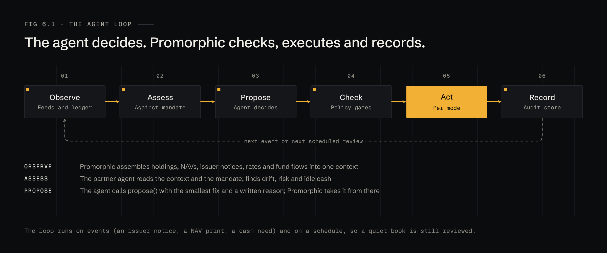
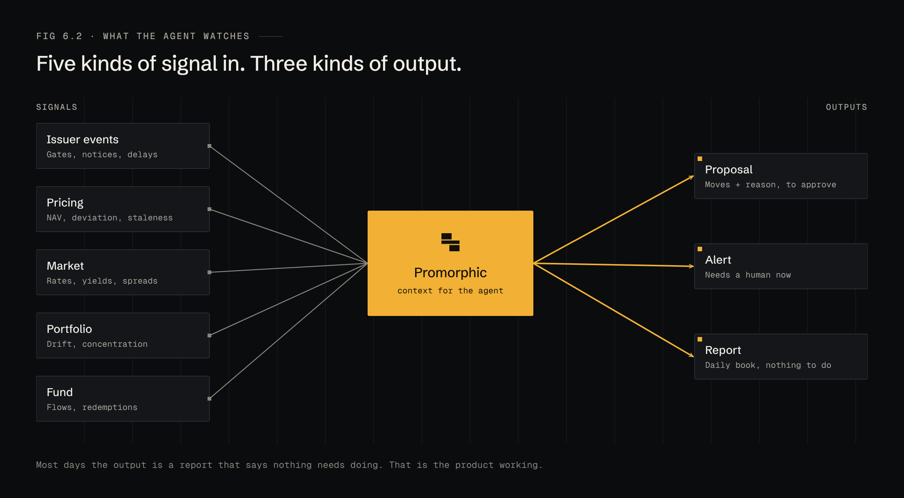
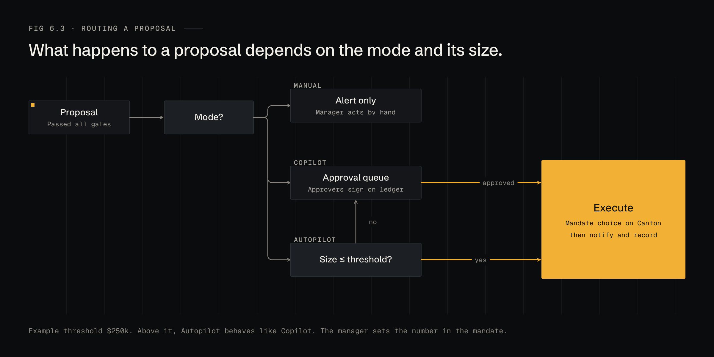
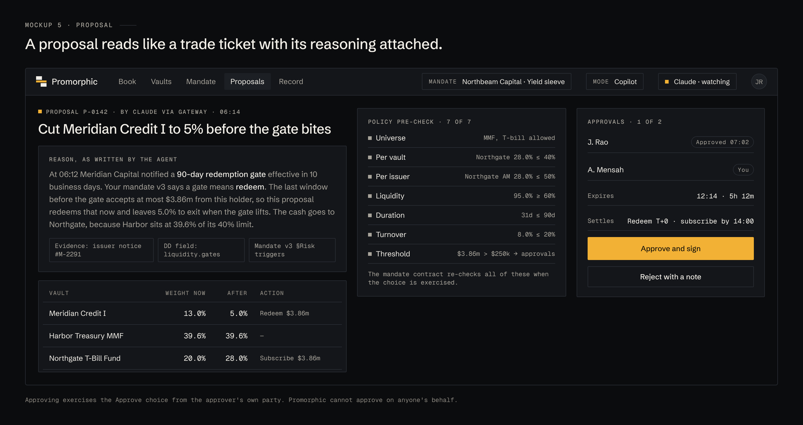

# 6 · Agents

AI agents are Promorphic's execution partners. They make the decisions. Promorphic gives them context and tools, and puts every decision through the mandate before it touches the ledger.

## The execution loop

| Step | Who | What happens |
|---|---|---|
| Observe | Promorphic | Holdings, NAVs, issuer notices, rates and fund flows assembled into one context |
| Assess | Agent | Reads the context and the mandate; finds drift, risk and idle cash |
| Propose | Agent | Calls `propose` with the smallest set of moves and a written reason |
| Check | Promorphic | Runs the policy gates |
| Act | Promorphic | Routes by mode; exercises Rebalance when allowed |
| Record | Promorphic | Files context, reason, gate results, signatures and the ledger reference |

The loop runs on events (an issuer notice, a NAV print, a fund flow) and on a schedule, so a quiet book is still reviewed every day.

## What the agent watches

Most days the output is a report that says nothing needs doing. That is the product working.

## Routing a proposal

## The agent gateway

Agents connect over MCP or REST with credentials scoped to one mandate. The tool surface is deliberately small:

| Tool | Does | Notes |
|---|---|---|
| `read_context` | Book, limits, headroom, recent signals | Read-only |
| `read_dd` | A vault's DD pack as structured fields | Read-only |
| `propose` | Creates a proposal: moves, reason, evidence references | Runs the gates; returns pass or fail with numbers |
| `explain` | Attaches reasons and evidence to a proposal | Required before routing |
| `rebalance` | Executes an approved or auto-eligible proposal | Promorphic exercises the choice; the agent never signs ledger transactions |
| ~~`transfer_out`~~ | — | Does not exist |

Any agent that speaks MCP can be connected, including the manager's own. Switching agents does not touch the mandate.

## The proposal

A proposal reads like a trade ticket with its reasoning attached: what moves, why, which evidence, which gates passed, who still has to sign, and when it expires.

## What we evaluate agents on

- **Accepted unchanged:** the share of proposals approvers sign without edits.
- **Gate failures:** proposals the agent should have known would fail.
- **Missed events:** signals that needed action where no proposal came.
- **Reason quality:** whether the cited evidence supports the move.

These numbers decide when a mandate is ready for Autopilot.
