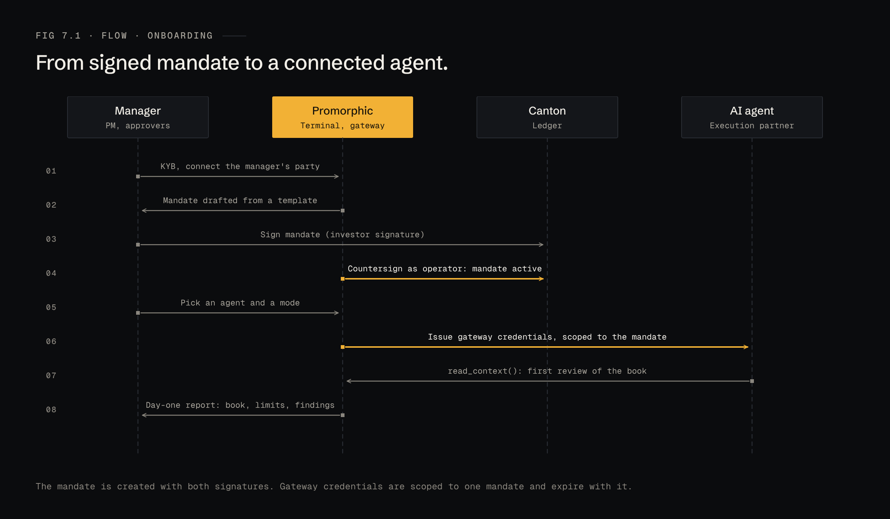
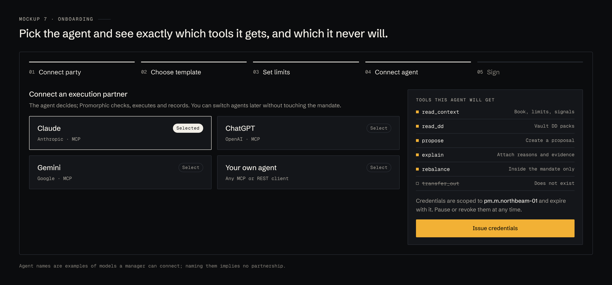
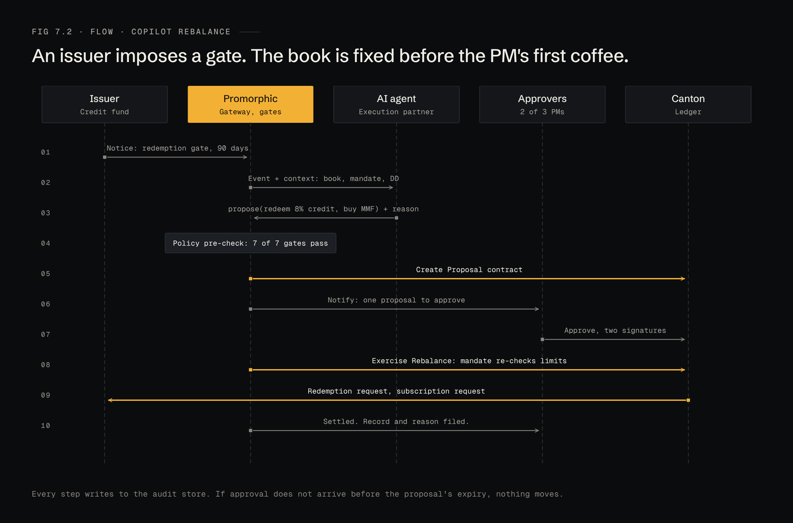
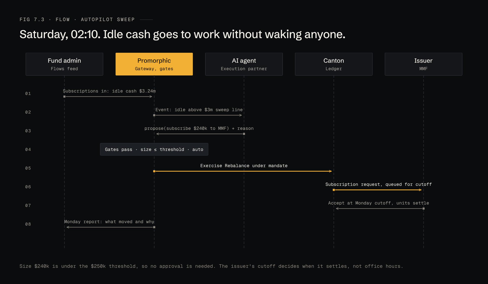
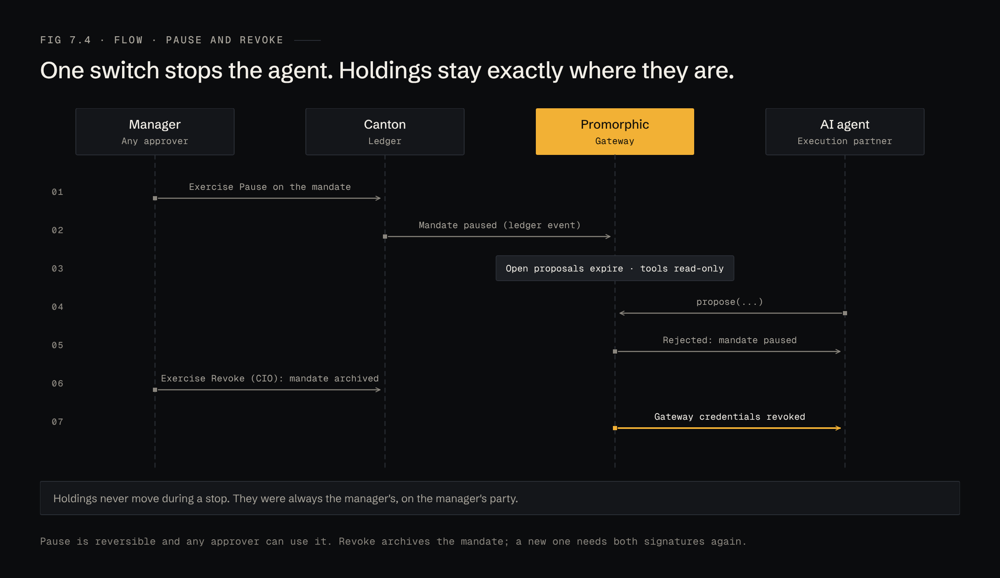

# 7 · Flows

Four flows cover the life of a mandate. Orange arrows are actions Promorphic takes on the ledger or with credentials; grey arrows are messages and reads.

## Onboarding

1. The manager completes KYB and connects its Canton party.
2. Promorphic drafts a mandate from a template.
3. The manager signs; Promorphic countersigns as operator. The mandate is active.
4. The manager picks an agent and a mode (Copilot by default).
5. Promorphic issues gateway credentials scoped to that mandate.
6. The agent runs its first review and the manager gets a day-one report.

## Copilot rebalance

An issuer imposes a redemption gate early in the morning. By the time the PM opens the terminal, a proposal is waiting with its reason and its gate results.

If approval does not arrive before the proposal's expiry, nothing moves.

## Autopilot sweep

Idle cash crosses the sweep line on a Saturday. The move is under the auto threshold, so it is executed without approval and queued for the issuer's next cutoff.

## Pause and revoke

Pause is reversible, and any approver can use it. Revoke archives the mandate and the agent's credentials with it. In both cases the holdings stay exactly where they are: on the manager's party.
