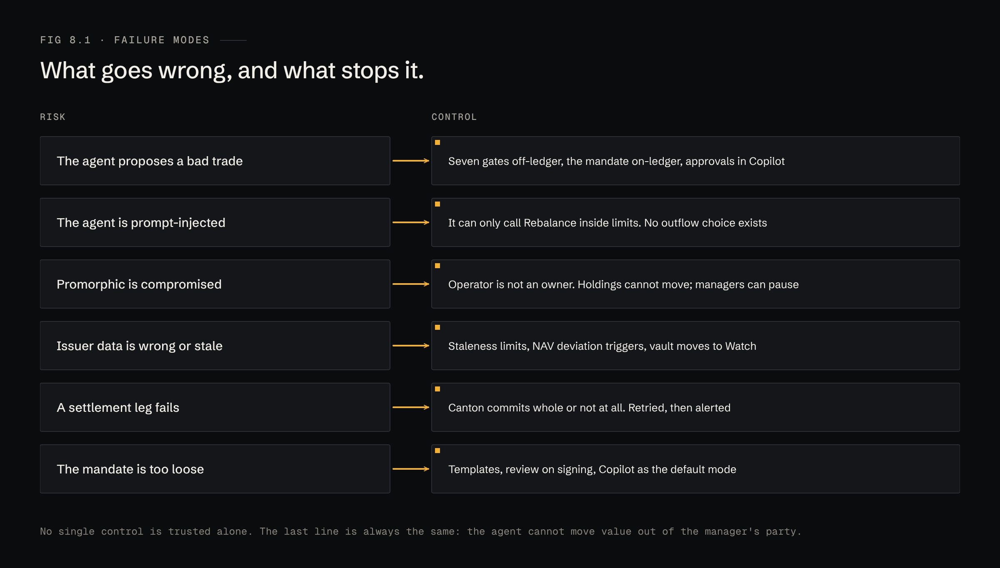
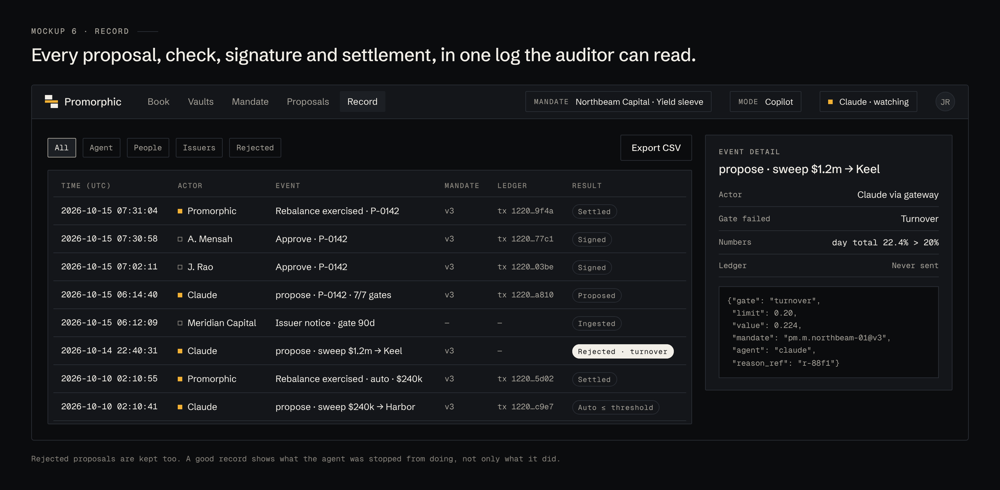

# 8 · Risk and control

## Failure modes

No single control is trusted alone. The last line is always the same: the agent cannot move value out of the manager's party.

## Controls the manager holds

| Control | Who | Effect |
|---|---|---|
| Limits | Set in the mandate, signed | Enforced before every action, off-ledger and on-ledger |
| Approvals | Approver quorum (e.g. 2 of 3) | Required for every Copilot action and every Autopilot action above threshold |
| Pause | Any approver | Agent tools go read-only; open proposals expire |
| Revoke | Named party (e.g. CIO) | Mandate archived, credentials revoked |
| Record | Anyone with access; exportable | Every action, rejection and signature, with ledger references |

Rejected proposals are kept. A good record shows what the agent was stopped from doing, not only what it did.

## Regulatory posture (to confirm with counsel)

- **Custody.** Promorphic never holds client assets: holdings are on the manager's party and no Promorphic contract can move them out. The intent is to stay outside custody regimes.
- **Discretionary management.** Copilot keeps the decision with the manager's approvers. Autopilot is discretionary execution within limits the manager sets, and may need a licence or a licensed partner depending on where the manager and Promorphic operate. This is one reason Autopilot ships after Copilot.
- **Distribution.** Listing an issuer's vault is distribution in some jurisdictions. Eligibility checks (professional investors only) sit in the vault terms and are checked at subscription.
- **Records.** The audit record is designed to meet a manager's own books-and-records duties, not to replace them.

None of this is legal advice. Every item above needs a written opinion before launch.
