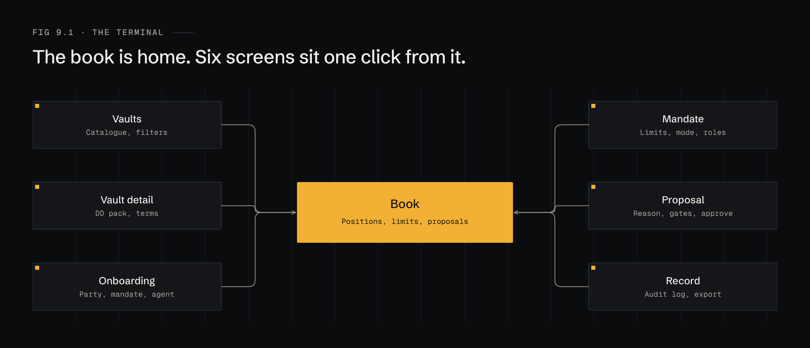
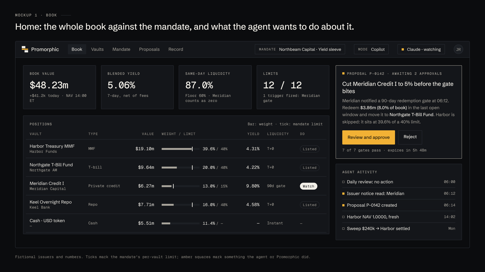
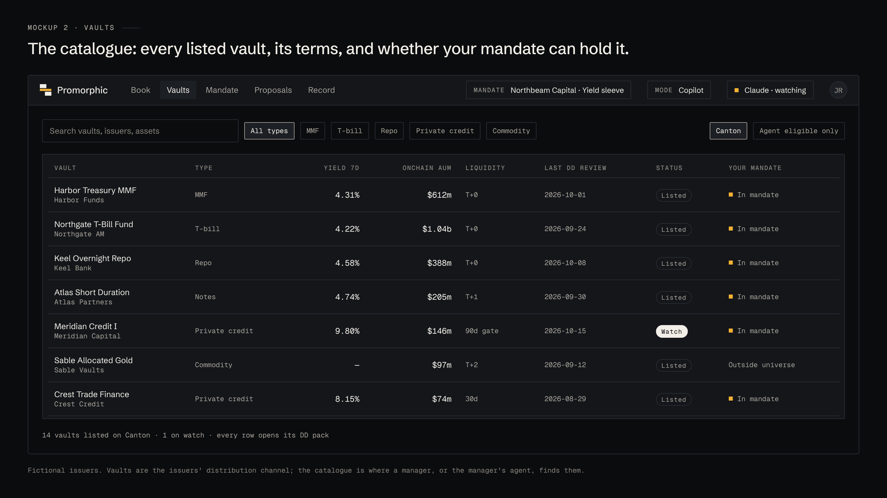
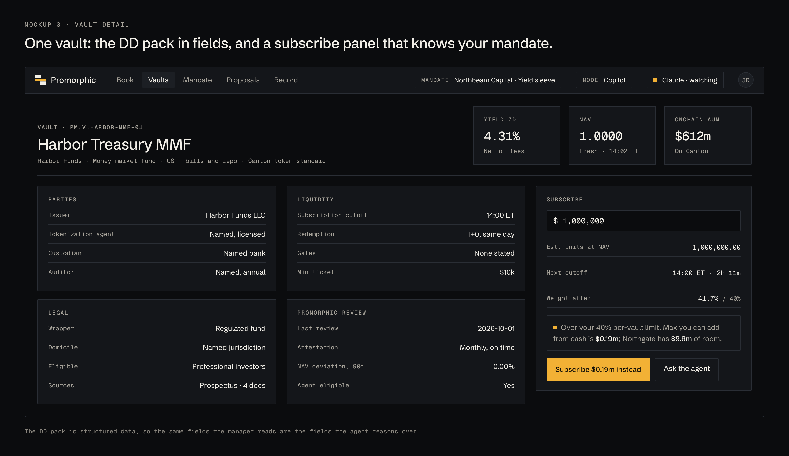
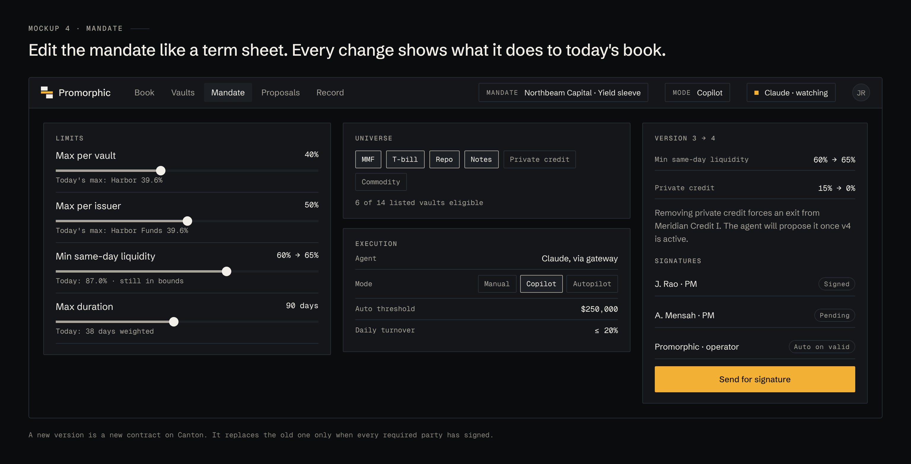

# 9 · The terminal

The customer is a desk, so the interface is a terminal: dense, numeric, keyboard-friendly, dark by default. It follows the Promorphic brand: neutral surfaces, neutral text, amber only for the mark, the one primary action on a screen, and the small square that marks something the agent or Promorphic did.

## Screen map

## 1 · Book

The home screen. Book value, blended yield, same-day liquidity and limit status across the top; every position with its weight against its mandate limit; the agent's open proposal and recent activity on the right.

## 2 · Vaults

The catalogue of listed vaults, filterable by type and by whether the current mandate can hold them.

## 3 · Vault detail

The DD pack as fields, plus a subscribe panel that checks the trade against the mandate before the manager presses anything.

## 4 · Mandate

Edit the mandate like a term sheet. Each change shows what it would do to today's book, and the new version goes out for signature.

## 5 · Proposal

The agent's reason, its evidence, the before and after weights, the gate results and the approvals, on one screen.

## 6 · Record

The audit log: every proposal, check, signature and settlement, filterable and exportable.

## 7 · Onboarding

Connect a party, pick a template, set limits, connect an agent, sign. The agent step shows exactly which tools the agent gets, and which it never will.

## Design notes

- Numbers are mono with tabular figures. Weights always show their limit.
- One primary (amber) button per screen. Everything else is outlined.
- Status is shown with weight and shape (a filled "Watch" pill), never with a new colour.
- Every agent-originated item carries the amber square, so a manager can see at a glance what the machine did.
