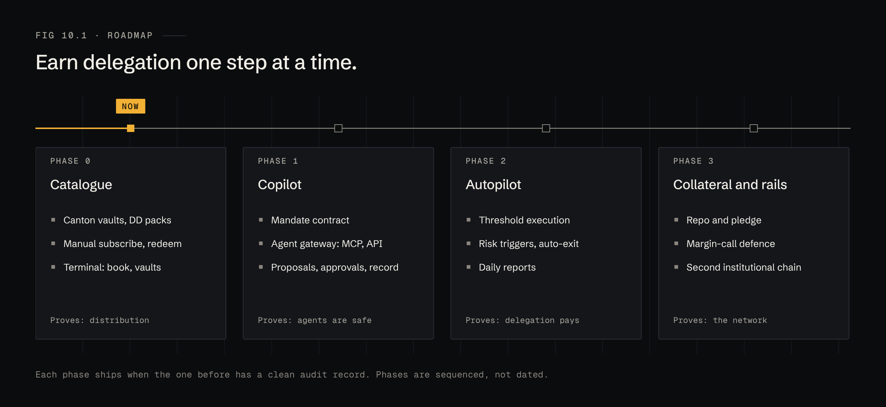

# 10 · Roadmap

| Phase | Ships | Proves |
|---|---|---|
| **0 · Catalogue** | Canton vaults with DD packs; manual subscribe and redeem; terminal with book and vaults | Issuers will distribute through us and managers will buy through us |
| **1 · Copilot** | Mandate contract; agent gateway (MCP, REST); proposals, approvals, record | Agents can be connected safely and their proposals get signed |
| **2 · Autopilot** | Threshold execution; risk triggers with auto-exit; daily reports | Delegation saves the desk time without new risk |
| **3 · Collateral and rails** | Repo and pledge; margin-call defence; a second institutional chain | The model works across the collateral market and beyond Canton |

Each phase ships when the one before has a clean record. Phases are sequenced, not dated.

## What we need to learn first

1. Which three to five Canton-issued instruments early customers want most.
2. Whether those issuers' subscription and redemption workflows can be driven by contract, or still need an off-ledger step.
3. What approvers need to see on a proposal before they will sign it without opening another tool.
4. Where the line sits, by jurisdiction, between Copilot and discretionary management.
