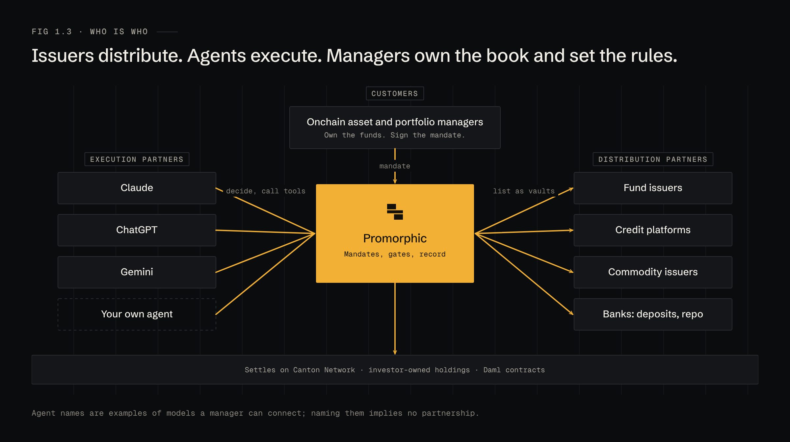

# Promorphic

**Promorphic is an AI treasury manager for tokenized assets. You set the mandate, the agent manages the portfolio within it, and it can never take custody of your funds.**

*(Working line. To be refined.)*

Tokenized assets are being issued on institutional chains, Canton first among them. The managers who allocate to those assets have to follow them there. Promorphic is the layer that lets them do it: a catalogue of vetted vaults, a mandate written as a contract, and AI agents that act on the book around the clock, inside limits they cannot break.

| | Who | What they get from Promorphic |
|---|---|---|
| **Customers** | Onchain asset managers, portfolio managers, fund treasuries, allocators | A book that is watched 24/7 and moved only inside their mandate |
| **Distribution partners** | Tokenized asset issuers | Buyers: every manager on Promorphic, and every agent acting for them |
| **Execution partners** | AI agents (Claude, ChatGPT, Gemini, or the manager's own) | A safe, typed way to act on tokenized assets |

## Contents

| # | Chapter | What it covers |
|---|---|---|
| 1 | [Thesis](01-thesis.md) | Why institutional chains, why now, who is who |
| 2 | [Product](02-product.md) | The four layers and the three operating modes |
| 3 | [Architecture](03-architecture.md) | Components, Canton parties and rights, defence in depth |
| 4 | [Vaults](04-vaults.md) | What a vault is, the DD pack, lifecycles |
| 5 | [Mandate](05-mandate.md) | The mandate contract, the custody boundary, policy gates |
| 6 | [Agents](06-agents.md) | The execution loop, signals, routing, the gateway tools |
| 7 | [Flows](07-flows.md) | Onboarding, Copilot rebalance, Autopilot sweep, pause and revoke |
| 8 | [Risk and control](08-risk-and-control.md) | Failure modes and what stops each one |
| 9 | [The terminal](09-terminal.md) | Screen map and seven mockups |
| 10 | [Roadmap](10-roadmap.md) | Phases, and what each one proves |
| | [Glossary](glossary.md) | Terms used across these docs |

## Three rules the whole design follows

1. **The manager owns the assets.** Holdings sit on the manager's own Canton party. Promorphic is an operator, never an owner.
2. **The agent decides; Promorphic enforces.** Partner agents choose what to do. Promorphic checks every action against the mandate, twice, and only then exercises it on the ledger.
3. **Every action has a reason and a record.** Nothing moves without a written reason, a gate result and a ledger reference in the audit record.

## About these docs

These docs describe the product as designed. They come before the code. Issuers, funds, managers and numbers in examples and mockups are fictional. Agent names are examples of models a manager can connect; naming them implies no partnership.

Figures and mockups are rendered from source in [`figures/`](figures/). See [`figures/README.md`](figures/README.md) to change and re-render them.
